<!-- README de profil GitHub — à placer dans le dépôt Bameth/Bameth (avec le dossier assets/) -->

  
  
  

 

  

<code>$ git diff avant..maintenant -- stack</code> &nbsp;·&nbsp; ce que je ne fais plus

 

 

  

