<a href="https://github.com/Bameth"></a>

<p align="center">
  <a href="https://www.linkedin.com/in/ameth-ba-2920b3253/"></a>&nbsp;
  <a href="mailto:amethba8826@gmail.com"></a>&nbsp;
  <a href="cv-ameth-ba.pdf"></a>
</p>

<br>

<picture>
  <source media="(prefers-color-scheme: dark)" srcset="assets/h-01-dark.svg">
  
</picture>


<br><br>

<picture>
  <source media="(prefers-color-scheme: dark)" srcset="assets/h-02-dark.svg">
  
</picture>

<p align="center">
  <a href="https://gogainde.sn/"></a>
  <a href="https://sunuterrain.com/"></a>
</p>
<p align="center">
  <a href="https://gogainde.sn/"></a>
  <a href="https://sunuterrain.com/"></a>
</p>

<br>

<picture>
  <source media="(prefers-color-scheme: dark)" srcset="assets/h-03-dark.svg">
  
</picture>


<details>
<summary><b>Ce que je n'utilise plus</b></summary>

```diff
- PHP
- Symfony / Twig
- MySQL
- JavaFX
- Hibernate / JDBC
- ASP.NET MVC
- Python
- SQL Server
- Bootstrap
- WordPress
+ la stack au-dessus
```

</details>

<br>

<picture>
  <source media="(prefers-color-scheme: dark)" srcset="assets/h-04-dark.svg">
  
</picture>

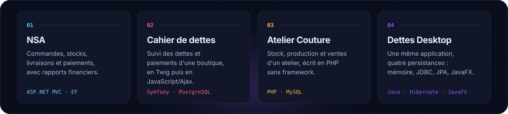

<br><br>

<picture>
  <source media="(prefers-color-scheme: dark)" srcset="assets/h-05-dark.svg">
  
</picture>


<br><br>

<picture>
  <source media="(prefers-color-scheme: dark)" srcset="assets/h-06-dark.svg">
  
</picture>

<p align="center">
  
  
</p>

<br>

<a href="mailto:amethba8826@gmail.com">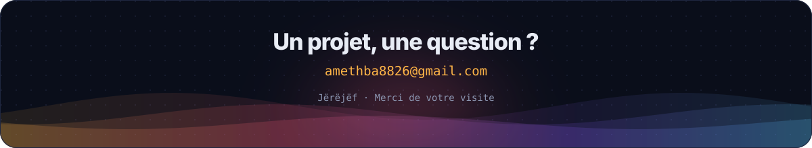</a>
